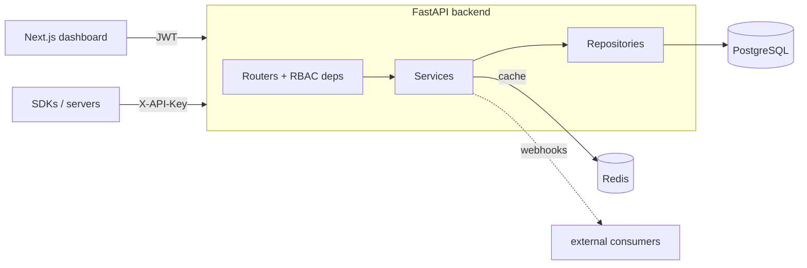

# SaaS Analytics Platform

[](https://github.com/Gilberthoughton/saas-analytics-platform/actions/workflows/ci.yml)
[](https://www.python.org/)
[](https://nextjs.org/)
[](LICENSE)

A multi-tenant **product analytics platform**: organizations ingest events
through authenticated API keys and explore real-time metrics, charts, and raw
events through a dashboard — with role-based access control, API-key management,
webhooks, and audit logging.

Built as a full-stack system — **FastAPI + PostgreSQL + Redis** backend and a
**Next.js + TypeScript** frontend — with clean architecture, a real test suite,
and a CI pipeline that runs against live PostgreSQL and Redis.

> **Why this exists:** a portfolio project intended to resemble a real SaaS
> codebase — service/repository layering, multi-tenancy, caching, RBAC, and
> CI/CD — rather than a tutorial to-do app.

---

## Table of Contents

- [Features](#features)
- [Tech Stack](#tech-stack)
- [Architecture](#architecture)
- [Database Schema](#database-schema)
- [Quick Start (Docker)](#quick-start-docker)
- [Local Development](#local-development)
- [API Overview](#api-overview)
- [Testing & CI](#testing--ci)
- [Project Structure](#project-structure)
- [Engineering Decisions](#engineering-decisions)

---

## Features

- **Authentication** — register (creates a user, organization, and owner
  membership), login (JWT), and `/me` with org context.
- **Multi-tenant organizations** — users belong to one or more orgs; the active
  org is selected via an `X-Org-Id` header. Every query is tenant-scoped.
- **Role-based access control** — `owner` > `admin` > `member`, enforced by a
  reusable dependency.
- **Event ingestion API** — single and batch endpoints authenticated by
  `X-API-Key`, with schemaless JSON properties.
- **Analytics dashboard** — summary metric cards (total events, events today,
  unique users, active API keys), an events-over-time chart, and a top-events
  chart. Results are **cached in Redis** and invalidated on ingestion.
- **Event explorer** — search/filter and paginate raw events.
- **API key management** — create (plaintext shown once), list, and revoke.
- **Webhooks** — register endpoints, receive HMAC-signed deliveries on matching
  events, and inspect delivery history.
- **Audit logs** — append-only record of security-relevant actions (admin-only).
- **Robust UI states** — loading, error (with retry), and empty states
  throughout; responsive layout.

## Tech Stack

| Layer            | Technology                                              |
| ---------------- | ------------------------------------------------------- |
| Frontend         | Next.js 15 (App Router), React, TypeScript, TailwindCSS |
| State / charts   | Zustand, Recharts                                       |
| Backend          | FastAPI, SQLAlchemy 2.0, Pydantic v2                    |
| Data stores      | PostgreSQL (system of record), Redis (cache)            |
| Auth             | JWT (PyJWT) + bcrypt; hashed API keys                   |
| Tooling          | Ruff, ESLint, pytest, Vitest, pre-commit                |
| Infra / CI       | Docker + Docker Compose, GitHub Actions                 |

## Architecture

Clean, layered architecture with dependencies pointing inward. Full diagrams
(system, component, ER) live in **[docs/ARCHITECTURE.md](docs/ARCHITECTURE.md)**.



- **Routers** handle HTTP, authn/authz, and status codes.
- **Services** hold business logic and own transaction boundaries (e.g. register
  = user + org + membership + audit, atomically).
- **Repositories** encapsulate all database access, always scoped by
  `organization_id`.
- **Core** provides config, DB sessions, the cache abstraction, security, and
  the RBAC guard.

## Database Schema

8 tables: `users`, `organizations`, `memberships` (the user↔org join carrying
the RBAC role), `api_keys`, `events`, `webhooks`, `webhook_deliveries`, and
`audit_logs`. A portable `GUID` type maps to PostgreSQL `UUID` and to `CHAR(36)`
on SQLite (used by the test suite). See the ER diagram in
[docs/ARCHITECTURE.md](docs/ARCHITECTURE.md).

## Quick Start (Docker)

```bash
git clone https://github.com/Gilberthoughton/saas-analytics-platform.git
cd saas-analytics-platform

# Create a local .env file (never commit it) with unique credentials:
# POSTGRES_PASSWORD=<generate-a-strong-password>
# SECRET_KEY=<generate-with-openssl-rand-hex-32>
# If the password has URL-reserved characters, URL-encode it for DATABASE_URL.
# Docker Compose now refuses to start without both variables.
docker compose up --build
```

- Dashboard → http://localhost:3000
- API docs (Swagger) → http://localhost:8000/docs

Register an account, create an API key, and POST events:

```bash
curl -X POST http://localhost:8000/api/v1/events \
  -H "X-API-Key: <your-key>" -H "Content-Type: application/json" \
  -d '{"name":"signup","distinct_id":"user-1","properties":{"plan":"pro"}}'
```

## Local Development

**Backend** (PostgreSQL + Redis via Docker, or SQLite via `.env`):

```bash
cd backend
python -m venv .venv && source .venv/bin/activate
pip install -r requirements.txt
cp .env.example .env            # set SECRET_KEY
uvicorn app.main:app --reload   # http://localhost:8000
```

**Frontend:**

```bash
cd frontend
npm install
cp .env.example .env.local      # NEXT_PUBLIC_API_URL
npm run dev                     # http://localhost:3000
```

## API Overview

Base path: `/api/v1`. Interactive docs at `/docs`.

| Method | Path                         | Auth     | Description                     |
| ------ | ---------------------------- | -------- | ------------------------------ |
| POST   | `/auth/register`             | —        | Register user + organization   |
| POST   | `/auth/login`                | —        | Obtain a JWT                   |
| GET    | `/auth/me`                   | JWT      | Current user + org + role      |
| GET    | `/members`                   | JWT      | List members                   |
| POST   | `/members`                   | admin+   | Add a member                   |
| PATCH  | `/members/{id}`              | admin+   | Update a member's role         |
| GET    | `/api-keys`                  | JWT      | List API keys                  |
| POST   | `/api-keys`                  | admin+   | Create an API key              |
| DELETE | `/api-keys/{id}`             | admin+   | Revoke an API key              |
| POST   | `/events` · `/events/batch`  | API key  | Ingest events                  |
| GET    | `/events`                    | JWT      | Explore events (filter/page)   |
| GET    | `/analytics/overview`        | JWT      | Cached metrics + series        |
| GET/POST/DELETE | `/webhooks…`        | JWT/admin| Manage webhooks + deliveries   |
| GET    | `/audit-logs`                | admin+   | Audit log                      |

## Testing & CI

```bash
# Backend — hermetic (SQLite + in-memory cache), no services needed
cd backend && SECRET_KEY=dev pytest

# Frontend
cd frontend && npm test
```

GitHub Actions ([`.github/workflows/ci.yml`](.github/workflows/ci.yml)) runs on
every push/PR:

- **Backend** — Ruff lint, the hermetic pytest suite, **and a smoke test against
  real PostgreSQL + Redis** service containers.
- **Frontend** — ESLint, `tsc`, Vitest, and a production build.
- **Docker** — builds both images.

## Project Structure

```
saas-analytics-platform/
├── backend/                 # FastAPI
│   └── app/{core,models,schemas,repositories,services,api}
│   └── tests/               # pytest (37 tests)
├── frontend/                # Next.js dashboard
│   └── src/{app,components,lib,store,types}
│   └── tests/               # Vitest
├── docker-compose.yml       # postgres + redis + backend + frontend
├── docs/ARCHITECTURE.md     # diagrams + schema + roadmap
└── .github/workflows/ci.yml
```

## Engineering Decisions

- **Service + repository layering.** Routers stay thin; business rules live in
  services; all SQL lives in repositories. Each layer is independently testable.
- **Tenant isolation at the data layer.** Every tenant query is scoped by
  `organization_id` in the repository — not trusted to the caller.
- **Read-through caching with invalidation.** Analytics are cached in Redis with
  a short TTL and invalidated on ingestion; the cache abstraction falls back to
  in-memory so the API stays up if Redis is unavailable, and tests run without it.
- **Secrets are never stored in the clear.** Passwords use bcrypt; API keys are
  stored as SHA-256 hashes with only a display prefix retained.
- **Hermetic tests + real-service CI.** The suite runs on SQLite + in-memory
  cache for speed and determinism; CI additionally smoke-tests the app against
  real PostgreSQL and Redis, so the production data path is exercised too.
- **Portable UUID type** keeps the same models working on PostgreSQL and SQLite.
- **Webhooks are best-effort and recorded.** Delivery is synchronous with every
  attempt logged; the documented production path is a durable queue with retries.

### Possible next steps

Alembic migrations, async ingestion via a queue, refresh tokens, per-tenant rate
limiting, and dashboards for webhook/delivery health.

---

Licensed under the [MIT License](LICENSE).
