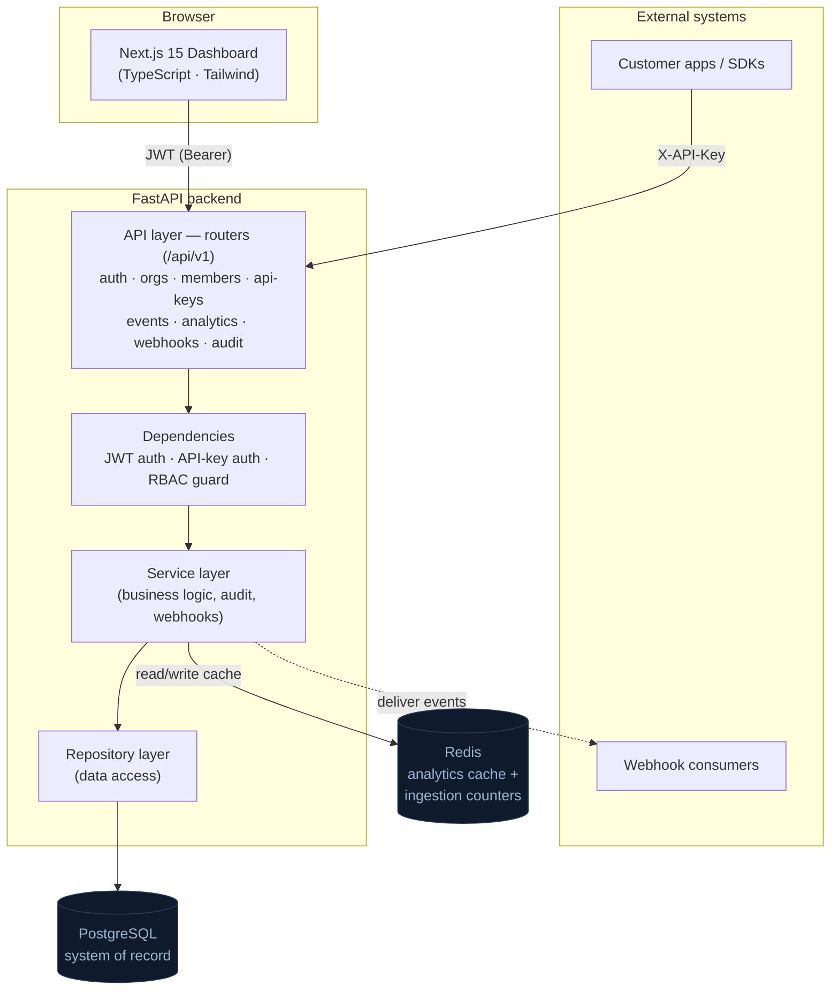
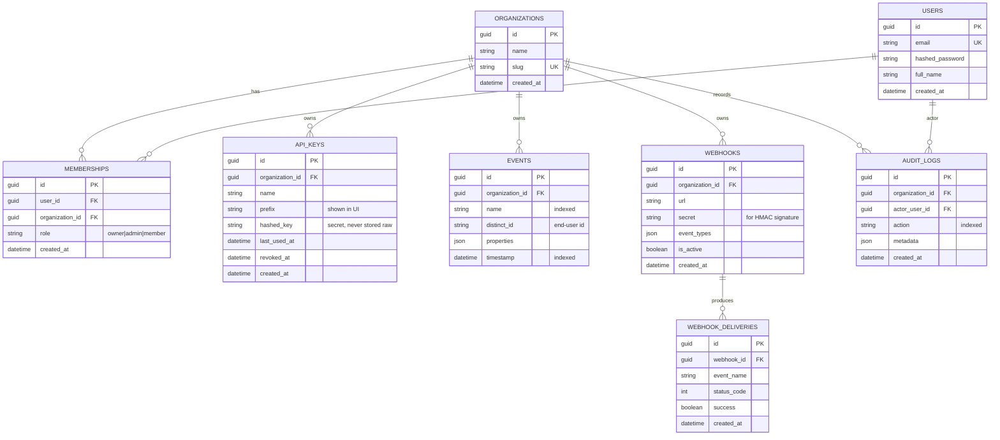

# Architecture

This document describes the system design, data model, folder structure, and
delivery roadmap for the SaaS Analytics Platform.

## Overview

A multi-tenant product-analytics platform: organizations ingest events through
authenticated API keys, and members explore those events and aggregated metrics
through a dashboard. The system is split into a **FastAPI** backend (the API and
business logic) and a **Next.js** frontend (the dashboard), backed by
**PostgreSQL** (system of record) and **Redis** (caching + ingestion counters).

## System architecture



**Request paths**

- **Dashboard → API:** the browser authenticates with a short-lived **JWT**
  (issued at login) and calls `/api/v1/*`. RBAC is enforced per route.
- **SDK → API:** customer systems send events to the ingestion endpoint
  authenticated by an **API key** (`X-API-Key`), scoped to one organization.
- **API → Webhooks:** on ingestion, subscribed webhook endpoints receive a
  signed delivery (best-effort, recorded for observability).

## Clean architecture (layering)

Dependencies point inward; each layer has one responsibility and is unit-testable
in isolation.

```
HTTP (routers)  →  Services (business logic)  →  Repositories (data access)  →  Models (ORM)
        \                       \                                              /
         └─ Schemas (Pydantic I/O) ──────── Core (config · db · cache · security · RBAC)
```

- **Routers** parse/validate input, enforce auth + RBAC, and return schemas.
- **Services** hold business rules (e.g. "registering creates an org + owner
  membership + audit entry") and are the only place repositories are composed.
- **Repositories** encapsulate every database query — no ORM calls leak into
  services or routers.
- **Core** provides cross-cutting infrastructure (settings, DB sessions, the
  cache abstraction, password hashing/JWT, and dependency guards).

## Database schema



**Integrity & multi-tenancy**

- Every tenant-owned row carries `organization_id`; repositories **always** scope
  queries by it, so one tenant can never read another's data.
- `MEMBERSHIPS` is the join between users and organizations and holds the
  **role** that drives RBAC (`owner` > `admin` > `member`).
- API keys store only a **bcrypt hash** of the secret plus a non-secret prefix;
  the raw key is shown exactly once at creation.
- `EVENTS.properties` is JSON (JSONB on PostgreSQL) for schemaless payloads;
  `name` and `timestamp` are indexed for explorer queries and time-series rollups.

## Folder structure

```
saas-analytics-platform/
├── backend/
│   ├── app/
│   │   ├── main.py                 # App factory, middleware, router mounting
│   │   ├── core/                   # config, database, cache, security, deps, types
│   │   ├── models/                 # SQLAlchemy ORM models
│   │   ├── schemas/                # Pydantic request/response contracts
│   │   ├── repositories/           # Data-access layer (all DB queries)
│   │   ├── services/               # Business logic (composes repositories)
│   │   └── api/v1/                 # Routers per resource
│   ├── tests/                      # pytest (SQLite + in-memory cache)
│   ├── Dockerfile
│   └── requirements.txt
├── frontend/
│   ├── src/
│   │   ├── app/                    # Next.js App Router (auth, dashboard, explorer…)
│   │   ├── components/             # Reusable UI + feature components
│   │   ├── lib/                    # API client, utils
│   │   ├── store/                  # Zustand (session/auth)
│   │   └── types/                  # Shared TS types mirroring the API
│   ├── tests/
│   ├── Dockerfile
│   └── package.json
├── docker-compose.yml              # postgres + redis + backend + frontend
├── docs/ARCHITECTURE.md
└── .github/workflows/ci.yml        # backend + frontend pipelines
```

## Development roadmap

| Phase | Scope | Status |
| ----- | ----- | ------ |
| 0 | Repo scaffold, docs, infra (compose, CI, health files) | in progress |
| 1 | Backend core (config, DB, cache, security, RBAC deps) | in progress |
| 2 | Auth + multi-tenant orgs + memberships (RBAC) | in progress |
| 3 | API keys + event ingestion + webhooks | planned |
| 4 | Analytics (cached metrics + time series) + event explorer | planned |
| 5 | Audit logs | planned |
| 6 | Backend test suite (pytest) green | planned |
| 7 | Frontend: auth, dashboard, explorer, API-keys, settings | planned |
| 8 | Frontend tests + production build | planned |
| 9 | CI/CD (Postgres + Redis service containers), final docs | planned |

> **Local testing note:** the backend runs on PostgreSQL + Redis via Docker
> Compose for real use. The automated test suite runs against SQLite and an
> in-memory cache so it is fast and hermetic; CI additionally runs it against a
> real PostgreSQL + Redis using GitHub Actions service containers.
